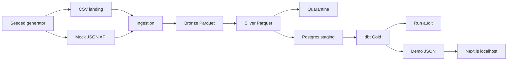

# CreditPulse

Synthetic medallion pipeline that keeps raw data, quarantines bad rows, and can be rerun without double-counting payments.



## Stack

| Piece | What actually runs |
| --- | --- |
| Language | Python 3.11+ (container is 3.12.16), pytest, ruff |
| Files | PySpark 3.5.3 deduplicates. PyArrow writes Parquet |
| Warehouse | PostgreSQL 16, upserts, dbt Core 1.8 with dbt-postgres |
| Orchestration | Airflow 2.10 LocalExecutor in Docker. No Celery or Redis |
| Demo | Next.js 15, read-only, fed by `web/data/*.json` |
| CI | GitHub Actions: ruff, unit tests, and the Postgres integration test. Airflow is not started in CI |
| Optional, still $0 | Vercel Hobby for the static site. Databricks Free Edition is documented and was not executed |

Kafka, MongoDB, Terraform, a paid data-quality product, and a credit model are not in this repository.

## Quick start

Docker Desktop is required. The pipeline runs in a container because Spark on Windows cannot launch its Python worker when the interpreter path contains a space.

```powershell
docker compose -f infra/docker-compose.yml up -d postgres
docker compose -f infra/docker-compose.yml --profile pipeline build pipeline
docker compose -f infra/docker-compose.yml --profile pipeline run --rm pipeline -m creditpulse.cli run --seed 42 --repayments 2000
cd web
npm install
npm run dev
```

Open http://localhost:3000. The same seed writes the same landing files. A second run of a committed batch does not add repayment rows.

```powershell
docker compose -f infra/docker-compose.yml --profile pipeline run --rm pipeline -m pytest
```

Host-only lint and unit tests, which do not start Spark:

```powershell
python -m venv .venv
.\.venv\Scripts\python -m pip install -e ".[dev]"
.\.venv\Scripts\python -m ruff check src tests
.\.venv\Scripts\python -m pytest -m "not integration"
```

Airflow UI (local placeholder password `admin`):

```powershell
docker compose -f infra/docker-compose.yml --profile orchestrate up -d
```

Details: [local setup](docs/runbooks/local-setup.md), [backfill](docs/runbooks/backfill.md), [failed-task retry](docs/runbooks/failed-task-retry.md).

## Tests

Measured on 29 October 2026 inside the pipeline container on this machine:

- `pytest`: 14 passed in 183 seconds. That includes the idempotent rerun, the quarantine reason counts, Gold reconciliation, SCD2, the stale replay, the fail-once watermark, and a 5-row increment.
- `dbt build` on the 100,000-repayment batch: 53 passed, 0 warnings, 0 errors.
- Host `pytest -m "not integration"`: 11 passed. Integration tests skip on Windows when the Python path contains a space and run in the container instead.
- Airflow `creditpulse_retry_demo`, triggered on this machine: the publish task failed once before the watermark commit and succeeded on the automatic retry. `gold.fact_repayment` stayed at 100,000 rows.

## Benchmark

One measured run. Not a scale claim. Source: [docs/benchmarks/latest.json](docs/benchmarks/latest.json).

| | |
| --- | --- |
| Machine | LAPTOP-561L7UNU, Docker Desktop on WSL2 |
| Runtime | pipeline container, Python 3.12.16, Spark `local[2]`, PostgreSQL 16 |
| Input | seed 42, 100,000 repayment events, batch `seed-42-n-100000` |
| Wall clock | 178.2 seconds |
| Generate / ingest / transform / load / dbt | 5.5s / 97.8s / 40.3s / 9.4s / 15.0s |
| Rows read / accepted / rejected / extra copies | 112,345 / 112,336 / 7 / 2 |
| Gold `fact_repayment` | 100,000 rows. Due 41,186,839.42 and paid 13,199,273.72 matched staging |
| Snapshot | 4,000 loans, 4,000 current customers, as of 2024-12-31 |

Accepted rows count customers, accounts, loans, customer events, and repayments together. The 7 rejects are the fixed defect catalog (missing fields, bad type, negative amount, unknown status, orphan key, maturity before origination). The 2 extra copies are one duplicate and one older replay; the replay did not replace the stored payment.

The delinquency rate on this snapshot is 1.0000. Days past due run from the oldest unpaid event to 31 December 2024, and the generator emits partial, late, and missed payments, so 3,989 loans fall in 90+ and 11 fall in 61–90. That is the definition applied to this synthetic mix, not a score from a risk model.

## Read next

- [PRD](docs/PRD.md)
- [Architecture](docs/architecture.md)
- [Data dictionary](docs/data-dictionary.md)
- [Local-first](docs/decisions/001-local-first.md), [Spark and dbt](docs/decisions/002-spark-vs-dbt.md), [Watermark and retry](docs/decisions/003-watermark-and-retry.md)
- [Vercel Hobby](docs/runbooks/vercel.md)
- [Databricks Free Edition](docs/runbooks/databricks-free-edition.md) — documented path, not executed

## Trade-offs

- PySpark owns the business-key window. dbt owns the warehouse metrics. The same metric is not implemented in both places.
- Gold is rebuilt from staging after each committed batch. The incremental boundary is the watermark, not a partial Gold merge. At 100,000 events the rebuild took 15 seconds, which is why a more elaborate incremental model was not added.
- The watermark and the success audit commit in one transaction, after load, dbt, and reconciliation. A crash before that leaves the cursor unchanged. Loads are upserts, so a retry does not double-count. That is at-least-once with idempotent writes.
- Ingest is the slow step (98 seconds of 178). Each source is collected through the Spark Python worker so the same code can run without Hadoop `winutils`. A larger volume would need a different write path; this repo stops at the measured 100,000-event run.
- The website reads exported JSON. A page request does not start Spark or query Postgres, and it does not show customer or account rows.

## Cloud

This copy was not pushed and was not deployed. Vercel Hobby and a public GitHub repository are the optional next steps; the commands are in the runbooks. Databricks Free Edition was not executed. The local pipeline does not need either account.

## Limitations

Synthetic data only. No real people, government IDs, or lending decisions. Outstanding balance is `max(principal - paid_to_date, 0)` and does not accrue interest. The local Airflow password and Fernet key are placeholders. This is not a production system, not a real-time feed, and not a petabyte-scale platform.
