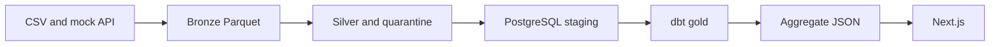

# Architecture

CreditPulse turns a seeded synthetic batch into analyst tables. The local path does not need a cloud account.

## Boundaries

- PySpark deduplicates on the business key. PyArrow reads and writes the Parquet files, so the job does not need Hadoop `winutils`. The rules live in `src/creditpulse/rules.py` and are called while rows are classified.
- dbt owns the warehouse model: dimensions, facts, the daily aggregate, and the warehouse tests. Metrics are not implemented a second time in Spark.
- The Next.js app reads JSON files written after a successful publish. A page request does not query Postgres or start Spark.
- Airflow calls the same CLI steps. It does not contain the business rules.

## Layers

Bronze keeps the source values plus `batch_id`, `source_name`, `ingested_at`, and `schema_version`. A retry overwrites that batch partition. Other batches stay.

Silver keeps one current repayment, account, and loan per business key. Customer history keeps one row per `customer_id` and `source_updated_at`. The newest `source_updated_at` wins. If two rows tie, the row already stored wins, so a rerun does not churn values.

Quarantine keeps the rejected row, the reason, and the batch id.

PostgreSQL staging is the upsert target. Gold is rebuilt from staging on each new batch. The incremental boundary is the batch cursor, not a partial Gold rebuild. Rebuilding Gold is deterministic and small enough for the local benchmark.

## Commit point

`ops.committed_batch` and `ops.source_watermark` change in the same transaction as the success audit row. That happens after the staging load, `dbt build`, and the reconciliation check. A crash before that transaction leaves the cursor where it was. The next attempt upserts the same keys.

## What is intentionally absent

Kafka, MongoDB, a paid quality service, and a credit-decision model are out of scope. Databricks Free Edition is documented as an optional follow-up in `docs/runbooks/databricks-free-edition.md`. This repository's evidence is the local run.
